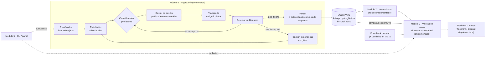

# Vinted Arbitrage Radar: arquitectura técnica y auditoría de viabilidad

> **Versión** 0.2 · octubre 2026
> **Autor:** Claude, en el rol de Principal Software Architect del proyecto
> **Estado:** Fase 1 (auditoría) cerrada · Módulo 1 (ingesta) implementado · núcleo del Módulo 2 (normalizador) · Módulo 3 (valoración contra el mercado de Vinted) y Módulo 4 (alertas Telegram/Discord) implementados con tests
> **Decisión v0.2:** **Vinted es el canal de reventa principal** (más fiable y rápido para el usuario); Wallapop queda como canal secundario (§2.5)

Este documento recoge la evaluación técnica, los riesgos y la arquitectura propuesta **antes** del código.
Las cifras de tarifas son las públicas a fecha de redacción. Todas son configurables y conviene revisarlas
cada trimestre: las plataformas las cambian sin aviso. Las fuentes están en la §8.

---

## 0. Resumen ejecutivo

| Pregunta | Respuesta corta |
|---|---|
| ¿Es viable el arbitraje de electrónica Vinted → mercado secundario? | **Sí, pero condicionado.** Es un negocio de nicho con márgenes ajustados, no una máquina de dinero. Hay que validarlo en **modo sombra** antes de arriesgar capital (§2.4). |
| ¿Dónde está la ventaja (el "edge")? | En que Vinted nació como mercado de moda: en electrónica hay vendedores que no conocen el precio de mercado, títulos pobres o erróneos, lotes que se pueden separar y bajadas de precio. **El edge está en clasificar mejor los anuncios, no en llegar antes que nadie.** |
| ¿Dónde se revende? | **En el propio Vinted** (decisión v0.2). El vendedor no paga comisión, igual que en Wallapop, así que la matemática es la misma. Además, el mercado que medimos es exactamente el mercado donde vendes. Riesgo nuevo: Vinted banea cuentas estándar con actividad comercial, así que a partir de cierto volumen hace falta **Vinted Pro** (§2.5). |
| ¿Qué descuento hace falta? | Para ganar ≥30 € netos con ROI ≥20 % revendiendo en Vinted o Wallapop hay que comprar **≥23–25 % por debajo del valor de mercado** en tickets de 250 € o más. Por debajo de ~150 € el ticket casi nunca compensa (§2.2). |
| ¿Cuál es el mayor riesgo técnico? | **DataDome**: Vinted lo usa como protección antibot desde 2025. La estrategia que recomiendo es de bajo perfil y degradación ordenada: si salta un bloqueo, el sistema se detiene y espera. No intenta superarlo a la fuerza (§3.1). |
| ¿Y el mayor riesgo de negocio? | Que **falte un precio de referencia fiable**. eBay cerró el acceso abierto a los precios de vendidos: la Finding API dejó de funcionar en febrero de 2025 y, según varios informes, desde julio de 2026 las búsquedas de vendidos exigen iniciar sesión. Por eso el precio de referencia sale del **mercado propio de Vinted**, que ya se mide (§3.2). |
| ¿Stack? | **Python 3.11+ con asyncio**, `curl_cffi` (huella TLS/HTTP2 de navegador real), **SQLite en modo WAL**, alertas por **Telegram** (Discord como alternativa). |

---

## 1. Riesgos críticos

Escala: **I** = impacto, **P** = probabilidad (A alta, M media, B baja).

| # | Riesgo | I | P | Mitigación de diseño |
|---|---|---|---|---|
| R1 | **Bloqueo antibot** (DataDome: captcha o 403, la IP o la sesión quedan marcadas) | A | A | Ritmo de peticiones parecido al de una persona, una única sesión coherente y *circuit breaker* que **para** al primer bloqueo, con enfriamiento creciente que se guarda entre reinicios. Nada de resolver captchas (§3.1). |
| R2 | **Cambio de la API interna** sin aviso (campos renombrados, endpoint retirado) | A | A | El parser es tolerante a variantes del esquema y lanza `SchemaDriftError` si el cambio es estructural. Hay un test de contrato `live` opcional y se alerta en cuanto falla. |
| R3 | **Referencia de precio sesgada o escasa** (FMV, *fair market value*) | A | A | El precio de referencia combina varias fuentes por jerarquía, con percentiles robustos, una confianza que depende del tamaño de la muestra y un histórico propio desde el día 1 (§3.2). |
| R4 | **Falsos positivos de *matching***: mando, juego o funda tomados por la consola; portátil con RTX tomado por la tarjeta gráfica; solo la caja | A | A | Reglas de exclusión por familia, precio mínimo en cada búsqueda, filtro por categoría y penalización cuando el descuento es "demasiado bueno" (§3.3). |
| R5 | **Fraude o producto defectuoso** (bloqueado por iCloud, IMEI en lista negra, piezas cambiadas, fotos robadas) | A | M | Detección de señales de alarma en el texto, reserva de riesgo en la fórmula y protocolo de recepción: probar el artículo dentro de la ventana de reclamación de Vinted. La verificación de electrónica de Vinted **solo existe en Reino Unido y Alemania**, no en España. |
| R6 | **Legal, condiciones de uso y protección de datos** | A | M | Uso personal, sin redistribuir datos, minimización de datos (solo el `seller_id` seudónimo, sin logins ni fotos de perfil), retención limitada y **ninguna automatización de cuenta** (ni login, ni compra, ni mensajes). |
| R7 | **Fiscal**: la reventa habitual es una actividad económica | A | A | Configuración opcional de IVA en REBU en el cálculo del margen. DAC7: las plataformas informan a Hacienda de quien supere 30 ventas o 2.000 € al año. Consulta con un asesor (§1.2). |
| R8 | **Competencia de bots** que consultan cada pocos segundos | M | A | No competir en latencia en los modelos más buscados. Competir en *matching* (anuncios mal titulados, lotes, bajadas de precio) y en el catálogo menos disputado (§2.1). |
| R9 | **Liquidez y depreciación** (cada lanzamiento de un modelo nuevo hunde el anterior; capital inmovilizado) | M | M | Filtro de liquidez, ROI anualizado según el tiempo esperado de venta y calendario de lanzamientos (septiembre para iPhone, etc.) como factor de riesgo. |
| R10 | **Arriesgar tu cuenta personal de Vinted** | A | M | La ingesta es **anónima**. La cuenta con la que compras nunca se usa para *scraping*. |
| R11 | **Ban por actividad comercial** al comprar y revender en Vinted con una cuenta estándar | A | M | Vinted retira anuncios y banea cuentas estándar con actividad comercial. Con volumen habitual, usa **Vinted Pro** (autónomo; se permite 1 cuenta estándar + 1 Pro). Fotos propias siempre (§2.5). |

### 1.1 Marco legal y contractual (no es asesoramiento jurídico)

- **Condiciones de uso.** Como la mayoría de marketplaces, Vinted restringe el acceso automatizado. Leer su API interna
  es una zona gris contractual, aunque los datos sean públicos. El riesgo realista no es penal: es que bloqueen la IP o la cuenta.
  De ahí R10 y que el sistema se detenga al primer bloqueo en vez de escalar.
- **Derecho *sui generis* sobre bases de datos** (Directiva 96/9/CE, arts. 133-137 del TRLPI). La extracción sistemática
  de partes sustanciales puede infringirlo. Mitigación: uso interno, sin republicar ni revender el dataset y con retención limitada.
- **RGPD.** El alias y el ID del vendedor son datos personales. Solo se guarda `seller_id`, para deduplicar y valorar
  el riesgo del vendedor. No se guardan alias, fotos ni descripciones de perfil. Retención propuesta: 180 días.
- **Ni compras ni mensajes automáticos.** Además de infringir las condiciones, son la vía más rápida para perder la cuenta.

### 1.2 Fiscalidad en España (resumen para planificar; confírmalo con un asesor)

- Revender con ánimo de lucro y de forma habitual es una **actividad económica**: alta censal (modelo 036/037), IAE,
  IRPF y obligaciones de IVA. Las condiciones de Vinted, además, reservan la venta profesional a **Vinted Pro**.
- **DAC7** (Ley 13/2023): las plataformas informan a la AEAT de los vendedores con ≥30 operaciones o ≥2.000 € al año.
- **REBU** (Régimen Especial de Bienes Usados): el IVA se paga **solo sobre el margen**, con una cuota de margen × 21/121.
  Está implementado como opción (`DealCosts.rebu_vat_rate`).
- Si vendes como profesional, los bienes de segunda mano tienen una garantía legal que puede pactarse en 1 año como mínimo,
  y en la venta a distancia hay 14 días de desistimiento. Ese coste esperado va en la **reserva de riesgo**.

---

## 2. Validación de la viabilidad del arbitraje en tecnología

### 2.1 Tesis: por qué existe la ineficiencia

1. **Asimetría de información.** La base de usuarios de Vinted es mayoritariamente de moda y la electrónica es una categoría joven.
   Muchos vendedores ponen precio "a ojo" o con prisa.
2. **Títulos pobres o erróneos.** "Consola Sony" sin decir "PS5", capacidad equivocada, modelo omitido. Las alertas por palabra clave
   (las de Vinted y las de los bots de la competencia) no los encuentran, pero un normalizador con reglas sí.
3. **Lotes.** "PS5 + 2 mandos + 5 juegos" a precio de consola sola: separar el lote genera margen.
4. **Bajadas de precio.** Un anuncio que baja un 15 % tras 10 días sin vender es una oportunidad nueva. El Módulo 1 ya las detecta.
5. **Diferencias entre canales.** Vendedores de Vinted y compradores de Wallapop son públicos distintos, con precios de equilibrio distintos.

**Dónde no está el edge:** en PS5, iPhone o AirPods recién publicados a precio bajo. Ahí compiten bots que consultan cada
pocos segundos y personas con las alertas nativas de Vinted. Con un ritmo de consulta prudente esa carrera está perdida.
Para esos modelos es mejor usar las búsquedas guardadas con notificación de la propia app de Vinted, que son oficiales y gratuitas.

### 2.2 La matemática: descuento mínimo necesario

Con el calculador implementado (`vinted_arb.valuation.fees`) y estos supuestos:

- Tarifa de Vinted para el comprador: 0,70 € + 5 % del precio.
- Envío de ida: 4,50 €. Embalaje: 1,50 €. Reserva de riesgo: 3 % del precio de compra.
- Umbrales: **≥30 € netos y ROI ≥20 %**.

Esto da el **precio máximo de compra** según el precio de venta esperado (*S*). Entre paréntesis, el descuento sobre *S*:

| S (precio de venta esperado) | Vinted o Wallapop (vendedor sin comisión) | eBay.es particular (11,5 % + 0,35 €) | Wallapop como profesional en REBU |
|---:|---:|---:|---:|
| 80 € | 40,09 € (−50 %) | 30,61 € (−62 %) | 32,46 € (−59 %) |
| 150 € | 104,90 € (−30 %) | 87,97 € (−41 %) | 96,28 € (−36 %) |
| 250 € | 187,57 € (−25 %) | 164,48 € (−34 %) | 177,86 € (−29 %) |
| 400 € | 303,85 € (−24 %) | 267,39 € (−33 %) | 288,90 € (−28 %) |
| 600 € | 458,89 € (−24 %) | 404,60 € (−33 %) | 436,96 € (−27 %) |
| 900 € | 691,47 € (−23 %) | 610,43 € (−32 %) | 659,05 € (−27 %) |

Puedes reproducir la tabla con `vinted-arb fees --sell 400 --min-net 30 --min-roi 0.20`.

**Conclusiones operativas**

- **El ticket mínimo útil es de ~150–200 €.** Por debajo, los costes fijos (tarifa fija, envío, embalaje) y el mínimo de 30 € exigen descuentos de más del 30–50 %.
  Eso suele indicar un producto roto o una estafa, no una ganga.
- **Por encima de ~150 € manda el umbral de ROI** y el descuento necesario se estabiliza en un 23–25 %.
- **Vinted y Wallapop dan el mismo margen**: en ninguno paga comisión el vendedor y el envío lo paga el comprador.
  La elección entre ellos es de liquidez y comodidad, y la v0.2 elige Vinted (§2.5). eBay exige unos 9 puntos más de descuento.
- **El "Bump" de Vinted** (destacar el anuncio, de pago, entre 3 y 7 días) es opcional. Se modela con `VA_PROMOTION_EUR`:
  cada euro de bump se resta del margen.
- **Operar en REBU** cuesta unos 4–5 puntos de descuento adicionales. Inclúyelo en el plan si vas a escalar.

### 2.3 Veredicto

**Viable** como operación selectiva con estas condiciones:

1. Tickets ≥150 €.
2. Familias con identificadores de modelo inequívocos (consolas, Steam Deck, iPhone/Galaxy por capacidad, GPU por modelo, audio y cámaras con referencia exacta).
3. Un precio de referencia propio y calibrado.
4. Un protocolo de recepción y prueba.

**No es viable** como "sniper" de alta frecuencia sin infraestructura antibot cara, que además no recomiendo (§3.1).

### 2.5 Decisión v0.2: Vinted como canal de reventa principal

**Por qué:** el usuario lo encuentra más fiable y con venta más rápida que Wallapop, y la matemática de comisiones es idéntica.
Hay además una ventaja de arquitectura: **el mercado que mide el Módulo 1 es el mismo en el que vas a vender**.
Los anuncios activos comparables (mismo SKU y estado) son tu competencia directa, así que el precio de referencia deja de depender de fuentes externas restringidas como eBay.

**Implicaciones de diseño (implementadas):**

| Aspecto | Cómo queda |
|---|---|
| Comisión de reventa | 0 para el vendedor; el comprador paga la "Vinted fee" y el envío (`VA_RESALE_CHANNEL=vinted`) |
| Precio de venta esperado | `P30 de comparables × κ` sobre el mercado propio de Vinted, más el *price book* manual para arrancar (§3.2) |
| Coste opcional | Bump o destacado (`VA_PROMOTION_EUR`) |
| Comparable ≠ candidato | El anuncio que se evalúa se excluye de su propio mercado |
| Calibración | κ y la liquidez se calibran con la detección de vendidos de M1.1 y con tus ventas reales (M5) |

**Riesgos y prácticas específicas de revender en Vinted:**

1. **Actividad comercial con cuenta estándar (R11).** Vinted indica que puede ocultar o retirar anuncios y banear cuentas estándar cuando detecta actividad comercial.
   Comprar y revender los mismos modelos en la misma plataforma es un patrón muy visible.
   A partir de un volumen habitual, date de alta en **Vinted Pro**: autónomo o sociedad en España; puedes tener 1 cuenta estándar y 1 Pro, con email y teléfono distintos.
   Los compradores de vendedores Pro pagan una "Buyer Protection Pro" cuyo importe no he podido confirmar: revísalo, porque afecta a lo competitivo que es tu precio.
2. **Fotos propias siempre.** No reutilices las fotos del anuncio original: son del otro vendedor, infringe las condiciones y los compradores reconocen las reventas.
3. **Cobro diferido.** El dinero de la reventa se libera tras la confirmación del comprador o al cerrarse el plazo de reclamación.
   Cuenta con 1–2 semanas de capital inmovilizado por operación en el ROI anualizado.
4. **Descripción honesta y prueba documentada.** Con el sistema de reclamaciones de Vinted, un vídeo del funcionamiento antes de enviar te protege como vendedor.

### 2.4 Puerta de validación (go/no-go): modo sombra

Antes de comprar nada, el sistema corre **2–4 semanas en modo sombra**. Detecta, valora y alerta, pero no se compra.
Las métricas salen de la base de datos:

| KPI | Objetivo para continuar |
|---|---|
| Precisión del *matching* en alertas (muestra de 100 revisada a mano) | ≥95 % |
| Alertas accionables por semana (pasan revisión manual y el anuncio sigue disponible ≥10 min) | ≥5 |
| Margen neto estimado mediano de las alertas accionables | ≥30 € |
| Tasa de bloqueo (aperturas del *breaker* por día) | ≤1 |
| Latencia p50 entre la publicación del anuncio y la alerta | ≤ intervalo de consulta |

Si no se cumplen, se ajustan el catálogo, las familias o los umbrales antes de invertir.
Si se cumplen, se registran las operaciones reales (compra y venta) para **calibrar** el modelo (Módulo 5).

---

## 3. Fase 1: auditoría técnica

### 3.1 Estrategia de extracción y antibot

#### Barreras actuales de Vinted

| Capa | Qué hace | Cómo se manifiesta |
|---|---|---|
| **DataDome** (Bot Protect + Account Protect, caso público de 2025) | Puntuación por petición con ML: huella TLS/HTTP2, coherencia de cabeceras, reputación de la IP, comportamiento y desafíos JS | `403` con JSON `{"url": "https://geo.captcha-delivery.com/captcha/..."}`, cabecera `x-datadome`, cookie `datadome` |
| **CDN/WAF** (Cloudflare en el borde) | Mitigación genérica y desafíos | `cf-mitigated: challenge`, HTML "Just a moment..." |
| **Huella TLS (JA3/JA4) y HTTP/2** | `requests`, `httpx` o `aiohttp` tienen huellas de cliente no-navegador triviales de detectar | Bloqueo o desafío desde la primera petición |
| **Sesión** | La API `/api/v2/catalog/items` exige las cookies de sesión (`access_token_web`, `_vinted_*_session`) que se obtienen al visitar la *home* | `401` cuando caducan |
| **Rate limiting** | Límites por IP y por sesión | `429`, a veces con `Retry-After` |

#### Comparativa de estrategias

| Estrategia | Coste mensual (orden de magnitud) | Resiliencia ante DataDome | Complejidad | Rendimiento | Comentario |
|---|---|---|---|---|---|
| **A. API JSON interna + cliente HTTP con huella de navegador** (`curl_cffi`) + cookies de sesión | ~0 € | Media a bajo volumen | Baja | Alto: 96 anuncios por petición, ~200–600 ms | No ejecuta JS: si DataDome exige un desafío JS, la sesión cae y hay que enfriar. |
| **B. Navegador *headless* "stealth"** (Playwright + stealth, Camoufox, nodriver) | ~0 € + CPU/RAM (200–400 MB por contexto) | Media-alta | Media-alta | Bajo: 2–5 s por página | Los plugins *stealth* conocidos están catalogados por los antibots. Útil como **arranque de sesión**, no como canal de datos. |
| **C. Proxies residenciales o APIs de *scraping*** | ~100–300 €/mes para ~90k peticiones (estimación) | Alta (delegada) | Baja | Medio | Destroza la economía de un MVP. Además, el consentimiento de muchas redes de proxies residenciales es dudoso. |
| **D. Canales oficiales** (Vinted Pro API con lista de acceso; alertas nativas de la app) | 0 € | Total | Nula | Limitado | La Pro API no es accesible para este caso. Las alertas nativas son un complemento excelente para los modelos más disputados. |

#### Recomendación: estrategia de bajo perfil (A + D, con B opcional más adelante)

1. **Canal de datos: A.** Petición JSON a la API de catálogo con `curl_cffi` imitando a un navegador real. La huella TLS, HTTP/2 y las cabeceras
   de identidad (`User-Agent`, `sec-ch-ua*`) las genera la propia suplantación de forma **coherente entre sí**.
2. **Perfil fijo por sesión; rotación solo tras un bloqueo.** Rotar el `User-Agent` en cada petición, que es la técnica "clásica",
   **perjudica** frente a DataDome: el mismo TLS y las mismas cookies con un UA distinto en cada petición son una incoherencia, y eso es señal de bot.
   El sistema elige un perfil de navegador (Chrome, Safari o Firefox, ponderado por cuota de mercado), lo mantiene toda la sesión
   y solo lo cambia cuando la sesión se descarta por bloqueo.
3. **Presupuesto de peticiones parecido al de una persona.** *Token bucket* a 6 peticiones/min con ráfaga de 2, *jitter* aleatorio
   (los intervalos perfectamente periódicos también delatan a un bot), búsquedas en serie y **una sola IP**.
   Ejemplo: 8 búsquedas cada 4 min ≈ 120 peticiones/h ≈ 2/min de media.
4. **Pipeline en dos etapas.** El catálogo (barato, 96 anuncios por petición) alimenta un prefiltro (normalizador + valoración optimista).
   Solo los candidatos pasan a la etapa 2 (detalle del anuncio y reputación del vendedor). Eso reduce las peticiones costosas en más de un 90 %.
5. **Degradación ordenada.**
   - Ante `403` o captcha, el *circuit breaker* se abre al instante y se descarta la sesión, porque sus cookies están marcadas.
   - Enfriamiento de 15 min ×2 en cada apertura consecutiva, hasta 6 h. El estado se guarda en SQLite para que reiniciar el proceso no se salte el castigo.
   - Ante `429` o `5xx`: reintento con *backoff* exponencial con *jitter* que respeta `Retry-After`.
   - Ante `401`: se renueva la sesión una sola vez.
6. **Lo que deliberadamente no se hace:**
   - Resolver captchas (con servicios o con ML).
   - Generar cookies de DataDome.
   - Rotar IPs residenciales para esquivar bloqueos.
   - Aleatorizar la huella del navegador.

   Son una carrera armamentística cara que DataDome está diseñado para ganar, y suben el riesgo legal (R6).
   Si la estrategia A deja de funcionar de forma sostenida a bajo volumen, el siguiente paso es B como **arranque de sesión**
   (un navegador real obtiene las cookies y el cliente HTTP las reutiliza). No es escalar la agresividad.
7. **Proxy opcional** (`VA_HTTP_PROXY_URL`) para una IP tuya: un VPS doméstico o la conexión de casa si el programa corre en otra máquina. No hay rotación de *pools*.

### 3.2 Precio de referencia (FMV, *fair market value*)

#### Estado de las fuentes en 2026

| Fuente | Tipo de precio | Acceso | Calidad | Uso |
|---|---|---|---|---|
| eBay Marketplace Insights API | **Vendidos** (90 días) | Lanzamiento limitado: requiere aprobación de negocio | Excelente | Solicitarla. No contar con ella. |
| eBay Finding API (`findCompletedItems`) | Vendidos | **Retirada el 5 de febrero de 2025** | — | — |
| Páginas de vendidos de eBay | Vendidos | Según varios informes de julio de 2026, **piden iniciar sesión**. Automatizar una cuenta infringe las condiciones. | Buena | Solo consulta manual puntual |
| eBay Browse API (oficial) | **Anuncios activos** (precio pedido) | Oficial y gratuita con cuenta de desarrollador | Media: el precio pedido es mayor que el de venta | Referencia corregida por κ (ver abajo) |
| Wallapop (API interna) | Anuncios activos + **desapariciones** | No oficial; mismo planteamiento de bajo perfil | Media-alta: es el canal de salida | Precio pedido + tiempo hasta desaparecer |
| **Mercado propio de Vinted** (Módulos 1 y 3) | Activos comparables + bajadas de precio (vendidos en M1.1) | **Implementado** | Alta en cuanto hay unas decenas de comparables por SKU | **Fuente principal** (canal de reventa = Vinted) |
| CeX (webuy) | Parrilla de compra (efectivo o vale) y de venta por grado | Web pública | Alta como **suelo de liquidez** | Precio de salida garantizado |
| *Price book* manual (`config/price_book.csv`) | Experto | Manual | Alta en los ~50 SKUs principales | **Arranque** (implementado) |

#### Método (Módulo 3, implementado en `valuation/market.py` y `valuation/reference.py`)

1. **Clave de valoración:** `SKU canónico × estado`. Ejemplo: `phone:iphone-15-pro:256gb × very_good`.
2. **Observaciones** de cada fuente con fecha y peso por recencia: $w_i = 2^{-\Delta t_i / h}$, con una vida media de $h$ = 14 días.
3. **Precio pedido → precio de venta.** El precio pedido se corrige con un factor $\kappa$ (`VA_FMV_ASK_TO_SALE`, hipótesis inicial 0,92), que descuenta las ofertas a la baja que aceptarás para vender rápido. Se calibrará con los vendidos detectados (M1.1) y tus ventas reales (M5).
4. **Limpieza robusta:** fuera las observaciones con $|x - \text{mediana}| > 3 \cdot \text{MAD}$, que suelen ser lotes, roturas o errores.
5. **Valor de referencia:** percentiles ponderados (Hazen). El **precio de venta rápida** es un percentil bajo de los comparables (`VA_FMV_PERCENTILE`, P30 por defecto): para vender rápido tienes que estar entre los más baratos de tu competencia.
   El precio de venta esperado es $S = \kappa \cdot \text{P30}$. También se registran P25, P50 y P75.
6. **Comparables válidos:** solo cuentan los anuncios con SKU completo, *matching* ≥0,8 y estado conocido, sin señales de descarte ni pantalla rota, lote ambiguo, contacto fuera de la plataforma o "solo cambio". El candidato se excluye de su propio mercado.
7. **Confianza del valor:** $C_{fmv} = \min\left(1,\ \sqrt{n_{\text{eff}} / n_{\min}}\right)$, con $n_{\min} = 12$ y $n_{\text{eff}} = (\sum w)^2/\sum w^2$.
8. **Muestras escasas por estado:** se agregan todos los estados del SKU normalizados con multiplicadores relativos a "Muy bueno", con un factor de confianza de 0,85. Los multiplicadores son **hipótesis iniciales que hay que calibrar con datos propios**:

| Estado canónico | Etiqueta en Vinted (ES) | Multiplicador inicial |
|---|---|---:|
| `new_sealed` | Nuevo con etiquetas / precintado | 1,20 |
| `new` | Nuevo sin etiquetas | 1,10 |
| `very_good` | Muy bueno | 1,00 |
| `good` | Bueno | 0,90 |
| `fair` | Satisfactorio | 0,78 |
| `for_parts` | (se detecta en el texto) | 0,35 |

9. **Combinación con el price book:** si conviven, $S = c \cdot S_{\text{mercado}} + (1-c)\cdot S_{\text{book}}$, siendo $c$ la confianza del mercado. La confianza del book es 0,7 si el precio tiene ≤30 días, 0,5 si tiene ≤90 y 0,3 si es más antiguo: la electrónica se deprecia.
10. **Ajustes por accesorios y otros factores** (pendiente, M3.1):
   - Caja y factura: +3–5 %.
   - Falta el mando de una consola: −40 €.
   - Batería del iPhone por debajo del 80 %: −8 %.

   Son tablas por familia y configurables.

### 3.3 *Matching* semántico y *scoring* de oportunidad

#### Normalización (implementada en `vinted_arb.normalization`)

1. Pasar a minúsculas, quitar acentos (NFKD), eliminar emojis y puntuación (se conservan `+ . / % - :`).
2. Separar unidades y sufijos: `256gb → 256 gb`, `13pro → 13 pro`, `promax → pro max`, `3060ti → 3060 ti`.
3. Extraer **capacidades** (`gb/go/tb/to`, `8/256`), **batería** (`batería 87 %`), **estado** (etiqueta de Vinted combinada con señales del texto),
   **accesorios** (caja, cargador, factura, garantía, mandos, juegos) y **señales de alarma**, con detección de negación
   ("sin iCloud" o "libre de iCloud" **no** son señal de alarma).
4. **Reglas por familia → SKU canónico**, con variantes que importan en el precio:
   - PS5: generación (original, slim o pro) y edición (digital o con lector). Los códigos `CFI-xxxxA/B` se descodifican.
   - Switch: Switch 2, OLED, V2 o Lite (sin confundir "Switch 2 juegos" con la Switch 2).
   - iPhone y Galaxy: modelo y capacidad.
   - GPU: modelo, variante Ti/Super y VRAM cuando cambia el precio. Se **excluyen** portátiles y PCs completos.
   - Steam Deck: LCD u OLED. Se infiere por capacidad cuando falta.
   - Audio: Sony WH/WF-1000XM y AirPods por generación.
   - Cámaras y drones: Fujifilm X100, Sony A7, GoPro y DJI Mini.
5. **Confianza del *matching*:** 0,95 si la regla encaja de forma explícita, −0,15 por cada variante relevante sin resolver
   y −0,10 si el modelo solo aparece en la descripción.

#### Escalado del *matching* por niveles (los siguientes hitos)

| Nivel | Técnica | Cuándo |
|---|---|---|
| 1 | Reglas y expresiones regulares por familia (hecho) | Los ~100 SKUs principales; máxima precisión |
| 2 | *Fuzzy* (`rapidfuzz.token_set_ratio`) contra los alias del catálogo | Erratas y modelos de la cola larga |
| 3 | *Embeddings* multilingües (e5/bge pequeños) + `sqlite-vec` | Títulos sin estructura y modelos nuevos |
| 4 | LLM pequeño como juez (opcional) | Solo candidatos ambiguos con margen potencial >40 €, para acotar el coste |

#### Clases de falsos positivos y defensas en capas

| Clase | Ejemplo | Defensa |
|---|---|---|
| Accesorio | "Mando PS5 DualSense", "Funda iPhone 15" | El título empieza por un sustantivo de accesorio, o aparece "para/compatible con" + dispositivo → `ACCESSORY_ONLY` |
| Juego | "Spider-Man 2 PS5" | Filtro de categoría en la búsqueda, `price_from` y penalización por descuento implausible |
| Equipo completo | "PC gaming RTX 4070", "Portátil RTX 4060" | Exclusión en la regla de GPU |
| Solo la caja o una pieza | "Caja vacía iPhone 14", "AirPod derecho" | `BOX_ONLY` / `PARTIAL_ITEM` |
| No es una venta | "Busco PS5", "Cambio por Switch" | `WANTED_AD` / `SWAP_ONLY` |
| Estafa | "Escríbeme por WhatsApp", precio −70 % | `OFF_PLATFORM` y penalización por descuento implausible |

#### Margen neto

$$
\text{Margen neto} = S - P_{\text{compra}} - \underbrace{(0{,}70 + 0{,}05\,P_{\text{compra}})}_{\text{tarifa Vinted}} - F_{\text{canal}}(S) - E_{\text{ida}} - E_{\text{vuelta}}\cdot\mathbb{1}_{\text{vendedor paga}} - \text{Embalaje} - r\,P_{\text{compra}} - \text{IVA}_{\text{REBU}}
$$

- $F_{\text{canal}}$: 0 en Wallapop y Vinted; $0{,}115\,(S + E_{\text{vuelta}}) + 0{,}35$ en eBay.es particular.
- $r$: reserva de riesgo, un 3 % por defecto.
- $\text{IVA}_{\text{REBU}} = \max(0, S - P_{\text{compra}}) \cdot \tfrac{0{,}21}{1{,}21}$, solo en modo profesional.
- Si la API devuelve `service_fee` para el anuncio, se usa ese importe exacto en lugar de la fórmula.
- $\text{ROI} = \text{Margen neto} / \text{Capital invertido}$ (compra + tarifa + envíos + embalaje).

#### Liquidez

- **Ritmo de ventas** $\lambda$ (ventas por semana del SKU y estado), estimado a partir de desapariciones en Wallapop y Vinted, con una corrección por anuncios retirados sin vender.
- **Probabilidad de vender en el horizonte $T$** al precio $S$: $P_{\text{venta}}(T) = 1 - e^{-\lambda_{\text{eff}} T}$,
  donde $\lambda_{\text{eff}}$ es el ritmo de salida de los anuncios con precio ≤ $S$, sacado de su supervivencia.
- **Filtro:** $P_{\text{venta}}(14\,\text{días}) \geq 0{,}5$ y al menos 2 ventas por semana observadas en el mercado.
- **Estado:** pendiente de M1.1, porque requiere detectar ventas reales en Vinted. Hasta entonces $P_{\text{venta}} = 1$ y la rotación la controla el percentil de venta rápida.
- **ROI anualizado**, para comparar usos del capital: $\text{ROI}_{\text{anual}} = (1+\text{ROI})^{365/\text{TTS}} - 1$, siendo TTS el tiempo hasta la venta.

#### Puntuación final y regla de alerta

$$
\text{Score} = \text{Margen neto} \cdot C_{\text{match}} \cdot C_{\text{fmv}} \cdot P_{\text{venta}}(T) \cdot (1 - R), \qquad R = 1 - \prod_i (1 - r_i)
$$

- **Riesgos $r_i$:**
  - Señales de alarma graves (`FOR_PARTS`, `LOCKED`, `REPLICA`, `BOX_ONLY`, `ACCESSORY_ONLY`, `WANTED_AD`): $r = 1$, descarte directo.
  - **Descuento implausible:** $r$ crece de forma lineal de 0 (con un descuento ≤40 %) a 0,6 (con ≥70 %). La puntuación **no** crece sin límite con el descuento:
    en electrónica, un precio demasiado bueno suele ser una estafa o un artículo roto.
  - Vendedor nuevo o sin valoraciones: $r = 0{,}15$ (etapa 2).

- **Se alerta si se cumplen todas estas condiciones:**
  - Margen neto ≥ `VA_MIN_NET_PROFIT_EUR`.
  - ROI ≥ `VA_MIN_ROI`.
  - $C_{\text{match}} \ge 0{,}8$ y $C_{\text{fmv}} \ge 0{,}6$ (`VA_MIN_MATCH_CONFIDENCE`, `VA_MIN_FMV_CONFIDENCE`).
  - Riesgo combinado $R \le 0{,}5$ (`VA_MAX_RISK`).
  - $P_{\text{venta}}(14\,\text{días}) \ge 0{,}5$ (cuando exista M1.1).
  - Ninguna señal de alarma grave.

- **Decisiones** (implementadas en `valuation/opportunity.py`):
  - `alert`: cumple todo y se notifica.
  - `watch`: margen positivo, pero algún umbral falla; se guarda para analizarlo en modo sombra.
  - `reject`: se descarta.

- **Riesgos blandos implementados:**

  | Señal | $r$ |
  |---|---:|
  | Contacto fuera de la plataforma | 0,6 |
  | Pantalla dañada | 0,5 |
  | Lote ambiguo | 0,4 |
  | "Solo cambio" | 0,3 |
  | Batería <80 % | 0,15 |
  | Estado desconocido (se valora como "bueno") | 0,1 |

### 3.4 Stack tecnológico

**Lenguaje: Python 3.11+ (asyncio).**

| Criterio | Python | Node.js / TypeScript |
|---|---|---|
| Huella TLS de navegador | **`curl_cffi`**: la referencia, con objetivos Chrome, Safari y Firefox actualizados | `got-scraping` / `curl-impersonate` con *bindings*, menos maduros |
| Navegador para el plan B | Playwright, **Camoufox (nativo en Python)**, nodriver | Playwright, Puppeteer y Crawlee (excelentes) |
| Datos y estadística | pandas, numpy, scipy, `lifelines` (supervivencia) | Limitado |
| Texto y *embeddings* | rapidfuzz, sentence-transformers, `sqlite-vec` | Más limitado en local |
| Tipado | `mypy --strict` + pydantic | TypeScript nativo |

Python gana porque el núcleo del valor está en la **valoración estadística y el *matching***, no en la automatización del navegador.

**Dependencias del MVP**

- **Requeridas:**
  - `curl_cffi`: transporte principal.
  - `httpx`: transporte alternativo y APIs oficiales (eBay Browse, Telegram).
  - `pydantic` / `pydantic-settings`: configuración y validación.
  - `PyYAML`: búsquedas guardadas.
- **Más adelante:** `rapidfuzz`, `typer` + `rich` (CLI del Módulo 5) y `lifelines`.

**Base de datos: SQLite en modo WAL** (`sqlite3` de la biblioteca estándar).

- Por qué: cero operaciones, un solo fichero, transaccional y de sobra para millones de filas de anuncios.
- Dinero en céntimos enteros y fechas ISO 8601 en UTC.
- **Migrar a PostgreSQL + pgvector** solo si hace falta acceso concurrente de varios procesos o el nivel 3 de *matching* a gran escala.
  `sqlite-vec` cubre el caso intermedio.

**Alertas**

- **Telegram Bot API**, como canal principal:
  - `sendPhoto` con una leyenda HTML que incluye el desglose del margen.
  - Botón *inline* "Abrir en Vinted" que lleva directamente al anuncio.
  - Instantáneo y gratuito.
- **Discord**, como alternativa: webhooks con *embeds*.
- **Salud del sistema** por el mismo canal: aperturas del *breaker*, cambios en el esquema de la API y búsquedas sin resultados.

**Observabilidad:** logging estructurado, tabla `poll_runs` (duración, anuncios vistos y nuevos, error) y estado del *breaker* en `kv`.

---

## 4. Arquitectura del sistema

### 4.1 Flujo de datos



### 4.2 Estructura del repositorio

```
├── ARCHITECTURE.md            ← este documento
├── README.md                  ← guía rápida
├── pyproject.toml             ← paquete, ruff, mypy, pytest
├── requirements.txt / requirements-dev.txt
├── .env.example               ← toda la configuración por variables VA_*
├── config/searches.yaml       ← búsquedas guardadas
├── config/price_book.csv      ← precios de venta manuales para arrancar (opcional)
├── src/vinted_arb/
│   ├── config.py              ← Settings (pydantic-settings) + carga de búsquedas
│   ├── models.py              ← SearchQuery, Listing, CatalogPage
│   ├── wiring.py              ← composición de dependencias desde Settings
│   ├── pipeline.py            ← orquestación: normalizar → valorar → alertar
│   ├── cli.py                 ← vinted-arb poll | runs | market | opps | evaluate | fees | parse-title | alert-test
│   ├── ingestion/             ← MÓDULO 1
│   │   ├── backoff.py         ← política de reintento exponencial con jitter
│   │   ├── circuit_breaker.py ← CLOSED/OPEN/HALF_OPEN, enfriamiento creciente, snapshot
│   │   ├── rate_limiter.py    ← token bucket asíncrono + jitter
│   │   ├── block_detector.py  ← clasifica respuestas (DataDome, Cloudflare, 429…)
│   │   ├── profiles.py        ← perfiles de navegador coherentes (UA + Client Hints + TLS)
│   │   ├── transport.py       ← curl_cffi / httpx tras una interfaz común
│   │   ├── parser.py          ← JSON del catálogo → Listing (tolerante a variantes)
│   │   ├── vinted_client.py   ← sesión, reintentos, breaker, búsqueda
│   │   ├── engine.py          ← planificador, deduplicación, paginación, línea base
│   │   └── errors.py
│   ├── storage/               ← SQLite: migraciones, anuncios, entidades, oportunidades
│   ├── normalization/         ← MÓDULO 2 (núcleo): texto, estado, catálogo, extractor
│   ├── valuation/             ← MÓDULO 3
│   │   ├── fees.py            ← comisiones, margen, ROI, REBU, precio máximo de compra
│   │   ├── market.py          ← percentiles ponderados, MAD, agregación por estado
│   │   ├── reference.py       ← mercado de Vinted + price book → precio de venta esperado
│   │   └── opportunity.py     ← riesgo, score y decisión alert/watch/reject
│   └── alerts/                ← MÓDULO 4: formato y notificadores Telegram/Discord
└── tests/                     ← pytest (unitarios + contrato `live` opcional)
```

### 4.3 Modelo de datos (esquema v2)

| Tabla | Contenido | Para qué |
|---|---|---|
| `listings` | Un registro por anuncio: precio actual, tarifa, estado, marca, foto, `seller_id`, `first_seen_at`, `last_seen_at`, búsqueda de origen | Deduplicación y base del histórico |
| `price_history` | `(listing_id, observed_at, price_cents)` en cada cambio | Bajadas de precio y elasticidad |
| `kv` | Estado persistente (breaker, búsquedas con línea base completada) | Que un reinicio no se salte el enfriamiento |
| `poll_runs` | Cada ejecución: búsqueda, duración, vistos, nuevos, estado, error | Observabilidad y KPIs del modo sombra |

| `listing_entities` | Resultado del normalizador por anuncio: SKU, estado, confianza, señales, `market_eligible`, versión del normalizador | Agregar el mercado por SKU; se recalcula solo al subir `NORMALIZER_VERSION` |
| `opportunities` | Última evaluación por anuncio: precio, venta esperada, margen, ROI, score, decisión, motivos, desglose, `alerted_at` y `alerted_price_cents` | KPIs del modo sombra; deduplicación de alertas (se vuelve a avisar solo si el precio baja ≥3 %) |

### 4.4 Patrones de resiliencia del Módulo 1

| Patrón | Implementación | Parámetros por defecto |
|---|---|---|
| **Rate limiting** | *Token bucket* asíncrono global + *jitter* en cada petición | 6/min, ráfaga 2, *jitter* del 35 % del intervalo |
| **Backoff exponencial** | *Equal jitter*, con espera mínima garantizada (más prudente que el *full jitter* frente a un servidor que limita). Respeta `Retry-After`. | Base 3 s, ×2, máximo 90 s, 4 intentos |
| **Circuit breaker** | Pasa a OPEN tras 3 fallos blandos seguidos o **al instante con un fallo duro** (403 o captcha). HALF_OPEN deja pasar 1 sonda, que caduca a los 120 s si no informa de su resultado, para que el breaker nunca se quede atascado. El enfriamiento crece en cada apertura consecutiva. El estado se guarda en `kv`. | 15 min → 30 → 60 … hasta 6 h |
| **Sesión** | Arranque por la *home* para obtener cookies. Se renueva a los 40 min o con un `401`; si es por caducidad, mantiene el perfil. Se **descarta con cambio de perfil** tras un bloqueo. | — |
| **Detección de cambios de esquema** | Falta `items` → `SchemaDriftError`. Un anuncio malformado se descarta y se registra sin tumbar el lote. | — |
| **Línea base** | La primera consulta de una búsqueda marca todo como visto sin emitir "nuevos", para no inundar de alertas. | Por búsqueda, en `kv` |
| **Aislamiento de fallos** | Un error inesperado en una consulta, o en el consumidor de anuncios nuevos, se registra y no detiene el bucle continuo. `poll --once` sale con código ≠ 0 si alguna búsqueda no obtuvo datos. | — |
| **Paginación incremental** | La página siguiente solo se pide si el anuncio más antiguo de la actual también es nuevo. | `max_pages` por búsqueda |

---

## 5. Fase 2: plan de implementación por hitos

| Hito | Alcance | Criterios de aceptación | Estado |
|---|---|---|---|
| **M0** | Arquitectura, entorno base (`.env.example`, `pyproject`, `requirements`, `.gitignore`), **Módulo 1 completo**, núcleo del normalizador y comisiones con tests | `pytest` en verde; `ruff` y `mypy` limpios; `vinted-arb poll --once` funciona en una máquina con salida a Vinted | ✅ |
| **M1.1** | Endurecer el Módulo 1: **detección de vendidos o retirados en Vinted** (prioritaria con Vinted como canal: calibra κ y da la liquidez); test de contrato `live`; **etapa 2** (detalle del anuncio: descripción y valoraciones del vendedor) solo para candidatos; horario activo configurable | Tasa de bloqueo ≤1 al día durante 7 días en modo sombra | Siguiente |
| **M2** | Normalizador v2: catálogo de los ~100 SKUs principales en YAML, nivel *fuzzy*, **dataset etiquetado de ≥500 títulos** con métricas de precisión y *recall* por familia | Precisión de SKU ≥97 % en el conjunto de test | Pendiente |
| **M3** | Valoración contra el **mercado propio de Vinted**: comparables, percentiles ponderados, MAD, agregación por estado, κ, *price book*, riesgo, *score* y tabla `opportunities` | Error absoluto mediano del valor de referencia ≤10 % frente a ventas reales registradas | ✅ Núcleo. Pendiente: liquidez (depende de M1.1) y ajustes por accesorios (M3.1) |
| **M4** | Alertas: Telegram (foto, desglose, botón al anuncio) y Discord; deduplicación por anuncio y precio; límite por hora; alertas de salud | Latencia p50 entre detección y alerta < 5 s; cero duplicados | ✅ Pendiente: resumen diario |
| **M5** | CLI (Typer + Rich) para gestionar búsquedas, umbrales e informes del modo sombra; **registro de operaciones reales** (compra y venta) para calibrar; panel opcional (Datasette o Streamlit) | P&L real frente a estimado por familia | Pendiente |

---

## 6. Supuestos que debes verificar (configurables)

1. **Tarifa de Vinted para el comprador** (0,70 € + 5 %): confírmala en el desglose del pago en vinted.es. Si la API trae `service_fee`, se usa ese importe.
2. **Envío de ida** (4,50 €) y **de vuelta** (6,00 €): dependen del transportista y del tamaño. Ajústalos por familia, porque una GPU no pesa lo mismo que unos AirPods.
3. **Comisiones de eBay.es** para particulares (11,5 % + 0,35 €): revisa la página oficial de tarifas. La reforma de julio de 2026 afectó a vendedores comerciales.
4. **Protección de Wallapop:** la paga el comprador, así que no afecta a tu margen directo, pero sí al precio que el mercado está dispuesto a pagar.
5. **Si pasas a Vinted Pro:** confirma si hay comisión para el vendedor Pro y cuánto paga el comprador ("Buyer Protection Pro"). Si el vendedor paga algo, crea un canal propio en `valuation/fees.py`.
6. **Coste del Bump:** depende del precio del artículo y de la duración (3 o 7 días). Consulta el importe en la app antes de fijar `VA_PROMOTION_EUR`.
7. **Etiquetas de estado de Vinted en electrónica** y **IDs de categoría** (`catalog_ids`): se descubren en la primera ejecución real y se configuran en `config/searches.yaml`.
8. **Multiplicadores de estado, P30 y κ = 0,92:** son hipótesis iniciales y se calibran con los datos del modo sombra.

---

## 7. Qué hace y qué no hace esta entrega

**Hace:**

- Consulta periódica de búsquedas guardadas en la API de catálogo de Vinted, con todos los patrones de resiliencia de la §4.4.
- Persistencia y deduplicación de anuncios, y detección de anuncios nuevos y de cambios de precio.
- Normalización de títulos a SKU, estado, accesorios y señales de alarma.
- Cálculo exacto de comisiones, margen y precio máximo de compra.
- Valoración de cada anuncio nuevo o rebajado contra el mercado propio de Vinted y el *price book*, con decisión `alert`, `watch` o `reject`.
- Alertas por Telegram (foto, desglose y botón al anuncio) y Discord, con deduplicación, límite por hora y avisos de salud.
- CLI para todo lo anterior (`market`, `opps`, `evaluate`, `alert-test`…).

**No hace (todavía):**

- Detectar ventas reales en Vinted, que alimentarán la liquidez y la calibración de κ (M1.1).
- Etapa 2 de detalle del anuncio (M1.1).
- Ajustes de precio por accesorios (M3.1).
- Resumen diario (M4).

**No hará:**

- Resolver captchas.
- Automatizar cuentas: ni login, ni compra, ni mensajes.
- Rotar *pools* de IPs para esquivar bloqueos.

---

## 8. Fuentes consultadas (octubre 2026)

- DataDome, caso de cliente de Vinted (Bot Protect + Account Protect): <https://datadome.co/customers-stories/vinted-partners-with-datadome-to-stop-account-fraud-protect-millions-in-revenue/>
- Vinted, "About the Vinted fee" (cambio de nombre de la tarifa de Protección al comprador): <https://www.vinted.com/help/1653>
- Vinted Francia, tarifa de protección del comprador (fijo 0,70 € + 5 %): <https://www.vinted.fr/help/342>
- Value Added Resource, cambios de condiciones de Vinted en Europa (octubre 2026: Vinted Pay, cambio de nombre de la tarifa, verificación de electrónica solo en Reino Unido y Alemania): <https://www.valueaddedresource.net/vinted-europe-terms-october-2026/>
- eBay.es, comisiones para vendedores particulares: <https://www.es.ebay.com/help/selling/fees-credits-invoices/comisiones-y-tarifas-para-vendedores-particulares?id=4822>
- eBay Developers, estado de retirada de APIs (Finding API, 5 de febrero de 2025): <https://developer.ebay.com/develop/apis/api-deprecation-status>
- eBay Developers, Marketplace Insights API (lanzamiento limitado): <https://developer.ebay.com/api-docs/buy/marketplace-insights/overview.html>
- OpenWeb Ninja, inicio de sesión obligatorio en las búsquedas de vendidos de eBay desde el 22 de julio de 2026 (fuente comercial, sin confirmación oficial): <https://www.openwebninja.com/blog/how-to-get-ebay-sold-and-completed-listings>
- Vinted, servicio Vinted Pro (quién puede darse de alta, 1 cuenta estándar + 1 Pro, Buyer Protection Pro): <https://www.vinted.com/help/918>
- Vinted Reino Unido, ayuda de Vinted Pro (retirada de anuncios y baneo de cuentas estándar con actividad comercial): <https://www.vinted.co.uk/help/1120>
- Vinted, "What is an item Bump?": <https://www.vinted.com/help/340>
- Comisiones de Wallapop en 2026 (fuentes de terceros): <https://ruit.es/herramientas/calculadora-comisiones-wallapop/> · <https://blog.beseif.com/wallapop-protect-funcionamiento-precios/>
